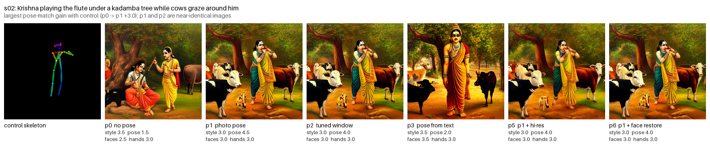

# The Next Ravi Varma

**Type a scene from the Indian epics, get a painting in the style of Raja Ravi Varma.**

A four-person course project (BITS Pilani, Goa). We fine-tuned **Stable Diffusion 1.5** with a **LoRA** on Ravi
Varma's paintings, added a text-understanding layer for epic scenes, then **pose control** (ControlNet OpenPose) and a
**web app** where a user types a scene, optionally gives a pose, and gets a painting back. Every claim in the reports
is tied to a result file in this repository, and each milestone was checked with blind human ratings on a held-out set
that was kept private until the end.


*One test scene: the pose skeleton (left) and the generated images under the M4 conditions (no pose, pose, tuned pose,
pose from text, hi-res, face restoration). From `eval/EVAL_REPORT_M4.md` §2.6.*

## The project in four milestones

| Milestone | What we built | Main result | Read this |
|---|---|---|---|
| **M1: data** | A provenance-logged dataset of Ravi Varma paintings (source, rights note, resolution per image), with captions | 147 paintings used for training; every source recorded | [`milestone1_2/m1_data/`](milestone1_2/m1_data/), [`TEAM_DECISIONS_M1`](milestone1_2/docs/TEAM_DECISIONS_M1.md) |
| **M2: style model** | A rank-16 LoRA (6.4 MB) on SD 1.5, trigger phrase `rrvarma style`; four training runs compared | Style score +0.037 (95% CI 0.025 to 0.049) over the best plain-SD baseline, better on 14 of 15 held-out prompts, no loss in prompt-following | [`EVAL_REPORT_M2`](milestone1_2/hub/rrvarma_lora_v1/EVAL_REPORT_M2.md), [model card](milestone1_2/hub/rrvarma_lora_v1/README.md) |
| **M3: text side** | Scene parser and knowledge base for epic characters, an LLM prompt expander, a checklist judge, and a SHAP attribution of prompt parts | Raw text + LoRA (**c1**) was at least as faithful as every expansion pipeline (c1 vs full system: −0.72 [−1.25, −0.25] dev, −0.50 [−0.83, −0.17] held-out), so c1 is the default. The *action* phrase carries most of the faithfulness (SHAP +0.230) | [`M3_REPORT`](docs/M3_REPORT.md), [`EVAL_REPORT`](eval/EVAL_REPORT.md), [`SHAP_ANALYSIS`](analysis/shap/SHAP_ANALYSIS.md) |
| **M4: pose + app** | ControlNet OpenPose, a pose library and pose-from-text, photo pose extraction, hi-res and face restoration, a Gradio app with a content policy | **A pose fixes posture** (human pose-match +1.59 dev, +1.75 held-out) but **not faces or hands**. Pose from text loses to a photo pose (−1.94 dev, −1.58 held-out). Hi-res stays opt-in (its dev gain did not replicate) | [`M4_REPORT`](docs/M4_REPORT.md), [`EVAL_REPORT_M4`](eval/EVAL_REPORT_M4.md), [`APP`](docs/APP.md) |

## Where everything is

| Folder | What is in it | Milestone |
|---|---|---|
| [`milestone1_2/`](milestone1_2/README.md) | M1 data and provenance, the M2 training kit, M2 evaluation tables, and the released LoRA (`hub/rrvarma_lora_v1/`) | M1, M2 |
| `m2kit/` | The M2 kit copied unchanged; the later pipeline calls it | M2 → M3 |
| `kb/`, `train/` | Character knowledge base and scene parser ([`KB.md`](kb/KB.md)) | M3 |
| `expander/` | LLM and template prompt expansion ([`EXPANDER.md`](expander/EXPANDER.md)) | M3 |
| `pipeline/` | `generate()`, `text_to_image()`, batch runner, token budget, controlled generation ([`PIPELINE.md`](pipeline/PIPELINE.md)) | M3, M4 |
| `analysis/shap/` | Shapley attribution of prompt parts | M3 |
| `pose/` | Pose skeletons, preset library, pose from text, photo pose extraction ([`POSE.md`](docs/POSE.md)) | M4 |
| `post/` | Hi-res and face-restoration steps | M4 |
| `app/` | The Gradio web app ([`APP.md`](docs/APP.md), [`CONTENT_POLICY.md`](docs/CONTENT_POLICY.md)) | M4 |
| `eval/` | Test scenes and pose pairs, scoring, judge, contact sheets, blind ratings and keys, evaluation reports, claims audit | M3, M4 |
| `results/` | Every score file the reports cite | M3, M4 |
| `docs/` | Milestone reports, team decision logs, figures, handoff notes | all |
| `config/`, `contracts/` | Shared settings (`m3.json`, `m4.json`) and data contracts; no setting is hard-coded | M3, M4 |
| `tests/` | CPU test suite (`pytest -q tests`) | all |

Images, model downloads and training runs live on Google Drive, not in git; manifests in the repo point to them. The
heavy M1/M2 files (paintings, grids, checkpoints) are in the original repository, linked from
[`milestone1_2/README.md`](milestone1_2/README.md).

## Try it

On a free Colab T4, run the [install cell](#m4-install-colab-t4) (it clones the repo, installs the `gen` profile and
post-processing), then:
```bash
python app/app.py --share --auth user:password
```
Then type a scene ("Hanuman kneeling before Rama, offering Sita's ring"), pick a pose (none, a preset, a photo or
"auto from text") and set the style and pose strength. Full instructions are in the [detailed guide](#detailed-guide) below.

## How we evaluated

- **Fixed test sets:** dev scenes for development, plus held-out scenes written privately and opened only after all
  decisions were made (M3: 12 scenes; M4: 6 scene+pose pairs).
- **Blind human ratings:** all four members rated coded images without knowing the condition (style, scene
  faithfulness; in M4 also pose match, faces and hands), two raters per image, with agreement reported.
- **Automated metrics:** a vision-language checklist judge, CLIP style margin, a pose-keypoint score (PCK), and a
  memorisation check against the training paintings. Each metric was checked against the human ratings; where it
  disagreed (M4's pose score), it was dropped from the headline.
- **Decisions before results:** hypotheses and decision rules were committed before the scored runs
  ([`experiments/`](experiments/), [`TEAM_DECISIONS_M3`](docs/TEAM_DECISIONS_M3.md),
  [`TEAM_DECISIONS_M4`](docs/TEAM_DECISIONS_M4.md)). A claims audit ([`CLAIMS_AUDIT_M4`](eval/CLAIMS_AUDIT_M4.md))
  checked every number in the M4 reports against a file.

## Limits and ethics

- Faces and hands are still often distorted; pose control does not fix them.
- Held-out sets are small (M4: 6 pairs, 36 rated images), so differences inside the confidence intervals are not claims.
- OpenPose gives body posture only: hand gestures (mudras), gaze and drapery are not controlled.
- The images imitate a style; they are not Ravi Varma's works. Ravi Varma died in 1906 and the paintings are public
  domain, but some museum scans have their own reuse terms (recorded in the provenance log).
- Uploaded photos are used only to extract a skeleton and are deleted when the request ends. No photo of a person
  is stored in this repository. The app has its own content filter; the SD safety checker is off because it blocks
  classical paintings ([`CONTENT_POLICY.md`](docs/CONTENT_POLICY.md)).

## Team

| Member | GitHub | M2 | M3 | M4 |
|---|---|---|---|---|
| Ananya Ranjit Shetty (A) | [@ananyashetty-bits](https://github.com/ananyashetty-bits) | Training environment and launch scripts; baseline run `A_base`; efficiency numbers, M3 handoff, cold-load test | Repository, generation pipeline, token budget, SHAP | ControlNet integration, control settings sweep |
| Kanupriya Vyas (B) | [@kanuvyas](https://github.com/kanuvyas) | Evaluation kit (leak check, metrics, `eval_run.py`, `compare.py`); caption run `B_v2caps`; M2 evaluation report, blind test, claims audit | Evaluation: test sets, judge, blind ratings, statistics | Evaluation: pose pairs and metric, ratings, held-out run, claims audit |
| Meghana M. (C) | [@mmeghana13](https://github.com/mmeghana13) | Generation and sweep tools, control-art set; rank-32 run `C_r32`; inference notes, names test, visual vocabulary | Knowledge base, scene parser, name-aware LoRA | Pose library, pose from text, photo pose extraction |
| Vaijayanthimala Navneet (D) | [@f20240393-pixel](https://github.com/f20240393-pixel) | Training datasets (`train_v1`, `train_v2`); learning-rate run `D_lr2e-4` (the selected model); model card, dataset card, hub release | Prompt expander, report assembly | Web app, hi-res and face restoration, content policy, release |

**Milestone 1 was done by all four together:** collecting the paintings, recording each one's source and rights in the
provenance log, and writing and checking the captions ([`milestone1_2/m1_data/`](milestone1_2/m1_data/)). In M2 each
member trained one LoRA variant that changed one setting against the baseline; the four runs are in
[`milestone1_2/bundles/`](milestone1_2/bundles/).

Releases: `m3-v1.0`, `m4-v1.0`.

---

# Detailed guide

**What the app uses:** the M3 default prompt (c1, raw text, no LLM) + `generate_controlled` (A) + the pose modules (C)
+ `post/` (D). Defaults and slider ranges come from `config/m3.json` and `config/m4.json`, never from the code.

## M4: install (Colab T4)
```python
from google.colab import drive; drive.mount('/content/drive')
import getpass, subprocess
tok = getpass.getpass("GitHub token (classic, 'repo' scope): ").strip()
subprocess.run(["git", "clone", f"https://{tok}@github.com/ananyashetty-bits/next-ravi-varma", "/content/m3"], check=True)
del tok
%cd /content/m3
!bash pipeline/setup_session.sh gen        # diffusers, ControlNet, pose detector, Gradio
!bash post/install_post.sh                 # only for face restoration (GFPGAN); hi-res needs nothing extra
```
Tested on a free T4 with Python 3.13, torch 2.14.1+cu130, diffusers 0.40.0, gradio 6.31.0 (post-processing pins in
`post/requirements_post.txt`). Run the cells in order. A's pins (`docs/CONTROL.md` §1): diffusers 0.40.0, transformers 5.17.0, peft 0.21.0, accelerate 1.15.0,
controlnet_aux 0.0.10, gradio 6.31.0, torch 2.14.1+cu130; OpenPose ControlNet revision
`9ae9f970358db89e211b87c915f9535c6686d5ba`.

## M4: run the app
```bash
python app/app.py --share --auth user:password
```
- `--share` prints a public `*.gradio.live` link. It goes through Gradio's relay, **dies when the Colab session
  ends**, and anyone who has it can use the GPU, so always set `--auth` (`docs/CONTENT_POLICY.md` §6).
- Hi-res and face restoration are opt-in checkboxes. Face restoration needs `post/install_post.sh`; without it the app
  says it was not applied (`APP_POST_MODULE=post.stub` turns both off). `APP_POSE_MODULE` selects the pose module (default `pose`, C's public entry point:
  real presets and `pose_from_text`). **Photo extraction (`extract_pose`) extracts real OpenPose skeletons from uploaded photos via `pose/extract.py`.**
- Without a GPU, `python app/app.py --no_model` builds the UI only.
- Inputs: scene text, pose mode (none / preset / upload photo / auto from text), style slider, pose slider, seed,
  post-processing boxes. Outputs: the labelled painting, the skeleton, the prompt and parsed characters, and a settings
  JSON.
- Every image carries the label *"AI-generated in the style of Raja Ravi Varma. Not an authentic work."* on the
  image and in the PNG metadata (`docs/CONTENT_POLICY.md` §3).

## M4: command line and batch
```bash
# one condition on the 16 dev pairs (p0 = --control none; p1 = baseline pose; p2 = tuned pose)
python pipeline/run_batch.py --expansions outputs/expansions/c1_lora_raw_dev.json --pairs eval/test_pairs_dev.json \
    --model rrv_v1 --condition p1_openpose --control openpose --control_profile baseline --control_source pair \
    --seeds 1 2 --out $IMG/p1_openpose@rrv_v1/dev
# post-processing on those images (p5 = hi-res, p6 = face restoration); writes full-size and _512 copies
python post/run_post.py --manifest $IMG/p1_openpose@rrv_v1/dev/manifest.json --condition p5_hires \
    --method hires_img2img --out $IMG/p5_hires@rrv_v1/dev
python post/run_post.py --manifest $IMG/p1_openpose@rrv_v1/dev/manifest.json --condition p6_restore \
    --method restore_gfpgan --out $IMG/p6_restore@rrv_v1/dev
# score with the M3 metrics (eval session)
python eval/score.py --manifest $IMG/p5_hires@rrv_v1/dev/manifest.json --pairs eval/test_pairs_dev.json \
    --out results/p5_hires@rrv_v1_dev.json
```

## M4: reproduce one image from a seed
The same inputs give the same image. Every PNG downloaded from the app stores its settings in the file's metadata
(`parameters`: text, seed, style and pose scale, pose mode, post-processing), and the app's settings JSON has the
same content. Without a pose, `text_to_image(text, seed=<seed>, mode="raw")` (see the M3 quick start below)
reproduces the base image. With a pose, use `run_batch.py` with the same `--seeds` and control flags.

## M4: uploads and privacy
A photo you upload is meant **only for extracting a skeleton**. The app deletes the uploaded file as soon as the skeleton
exists (also when the prompt is refused): measured, no copy is left when the request finishes. If that ever fails,
Gradio's own timer removes it (measured at 360 s), so **uploads are deleted within N = 6 minutes**
(`results/app_upload_cache*.json`; temp path `/tmp/gradio`, `docs/APP.md`). We do not claim that uploads are
"not saved". Photos of people are never committed to the repo or put on the shared Drive.

## M4: documents
`docs/APP.md` (app, post-processing), `docs/CONTENT_POLICY.md`, `docs/CONTROL.md` (A), `docs/POSE.md` (C),
`eval/EVAL_REPORT_M4.md` (B), `docs/M4_REPORT.md` (the assembled report).

---

# Milestone 3 documentation (still valid)

Turn a plain-language scene from the Indian epics ("Hanuman kneeling before Rama, offering Sita's ring") into an
image in Raja Ravi Varma's style. M3 adds the text side to M2's style model (Stable Diffusion 1.5 + the `rrv_v1`
LoRA): a scene parser and knowledge base, a prompt expander, and an evaluation of whether any of it helps.

**Result in one line:** on both the dev and the held-out set, raw text with the LoRA (**c1**) was at least as
faithful to the scene as every prompt-expansion pipeline. c1 is the default pipeline (`docs/TEAM_DECISIONS_M3.md`;
evidence in `eval/EVAL_REPORT.md`).

## What runs where
Everything runs on a **free Colab T4**. The LLM, the diffusion model and the judge each need the GPU to themselves,
so they run in **separate Colab sessions** and exchange files on Google Drive.

| Profile | Install | Used for |
|---|---|---|
| `gen` | `bash pipeline/setup_session.sh gen` | image generation (`pipeline/`) |
| `llm` | `bash pipeline/setup_session.sh llm` | LLM prompt expansion (`expander/`) |
| `eval` | `bash pipeline/setup_session.sh eval` | judge + metrics (`eval/`) |
| tests | `pip install pytest jsonschema rapidfuzz pyyaml numpy pillow` | `pytest -q tests` (CPU) |

**Drive prerequisites** (paths are set in `config/m3.json`):
- The M2 LoRA must be at `/content/drive/MyDrive/m2/hub/rrvarma_lora_v1/pytorch_lora_weights.safetensors`
  (sha256 `067ee19f…`).
- The base model `stable-diffusion-v1-5/stable-diffusion-v1-5` and the LLM `Qwen/Qwen3-4B-Instruct-2507`
  download from Hugging Face on first use.

## Quick start: one image with the default pipeline (Colab, T4)
```python
from google.colab import drive; drive.mount('/content/drive')
import getpass, subprocess
tok = getpass.getpass("GitHub token (classic, 'repo' scope): ").strip()   # the repo is private
subprocess.run(["git", "clone", f"https://{tok}@github.com/ananyashetty-bits/next-ravi-varma", "/content/m3"], check=True)
del tok
%cd /content/m3
!bash pipeline/setup_session.sh gen
```
```python
from pipeline.generate_api import text_to_image
image, expanded, scene = text_to_image("Sita sitting alone under a tree in the Ashoka grove, sorrowful", seed=1, mode="raw")
image.save("sita_s1.png"); print(expanded["positive"])
```
`mode="raw"` is the default pipeline (c1): `rrvarma style, <your text>, oil painting, canvas texture, classical indian art`
on SD1.5 + `rrv_v1`, DPM++ 2M, 30 steps, CFG 7.0, 512×512, negative `ugly, blurry, bad anatomy`. The same seed
gives the same image (a fresh generator per call). The first call loads the model (about 1 minute in a fresh
session); after that, each image takes about 5 s on a T4 (`pipeline/PIPELINE.md` §5).

**Same thing from the command line:**
```bash
python pipeline/cli.py generate "Sita sitting alone under a tree in the Ashoka grove, sorrowful" --mode raw --seed 1 --out sita_s1.png
```
**Demo notebook:** `pipeline/demo.ipynb` (open it in Colab with a T4): three scenes, a same-seed check, base vs LoRA,
the CLI, and one KB-based mode. It is also the cold-start test.

## Other pipelines (the M3 ablation)
| `mode` | Condition | What the model sees |
|---|---|---|
| `raw` | c1 (**default**) | trigger + raw text + style tail |
| `template` | c2 | deterministic template from the parsed scene |
| `llm_kb` | c3 | LLM expansion with KB character descriptions |
| `llm_nokb` | c4 | LLM expansion without the KB |
| `llm_kb_layout` | c5 | c3 + layout phrases (built, not evaluated) |
| model `base` + `raw` | c0 | the same, without the LoRA |

`text_to_image()` uses C's parser (`kb/parser.py`) and KB for every mode. The LLM modes load a 4B LLM first, then
free it before generating. For many scenes, use the batch route below (expand with `expander/batch_expand.py`, then
generate with `pipeline/run_batch.py --expansions …`), which is how every evaluated image was made.

## Batch runs (how all evaluated images were made)
```bash
# expansions (llm session)
python expander/batch_expand.py --scenes eval/test_scenes_dev.json --split dev --mode llm_kb --kb kb/kb.json \
    --condition c3_llm_kb_ckb --out outputs/expansions/c3_llm_kb_ckb_dev.json
python expander/check_expansions.py outputs/expansions/c3_llm_kb_ckb_dev.json --strict
# images (gen session): raw text, or from an expansion file
python pipeline/run_batch.py --raw eval/test_scenes_dev.json --condition c1_lora_raw --seeds 1 2 --out <dir>
python pipeline/run_batch.py --expansions outputs/expansions/c3_llm_kb_ckb_dev.json --seeds 1 2 --out <dir>
# scoring (eval session)
python eval/score.py --manifest <dir>/manifest.json --scenes eval/test_scenes_dev.json --out results/<cond>@<model>_dev.json
```
`run_batch.py` resumes after a disconnect and writes a `manifest.json` that records the git sha, the config hash,
the LoRA sha256, library versions and per-image seconds.

## Runbooks (copy-paste Colab cells)
- `expander/RUNBOOK_COLAB.md`: LLM session, expansions, frozen held-out commands.
- `eval/RUNBOOK_B.md`: scoring, judge, blind contact sheets, rating stats, the held-out run (§7).

## Repository map
| Path | What |
|---|---|
| `config/m3.json` | the single source of settings (model, sampler, trigger, tail, negative, token budget, seeds) |
| `pipeline/` | `generate_api.py` (`generate`, `text_to_image`), `run_batch.py`, `cli.py`, `demo.ipynb`, `PIPELINE.md` |
| `kb/` | parser, knowledge base (`kb.json`, `kb_llm.json`, `names.json`), `KB.md` |
| `expander/` | prompt expander, prompts, interim KB, `EXPANDER.md` |
| `train/` | names-aware LoRA experiment, `NAMES_MODEL.md` |
| `eval/` | test scenes (dev + held-out), judge, scoring, ratings, stats, grids, `EVAL_REPORT.md`, `CLAIMS_AUDIT.md` |
| `results/` | scored results per condition and split; human-rating summaries; `rated/` = the exact files paired with ratings |
| `outputs/expansions/` | every expanded prompt that was generated |
| `experiments/HYPOTHESES.md` | pre-registered hypotheses and dated deviations |
| `docs/` | `M3_REPORT.md`, `TEAM_DECISIONS_M3.md`, `HANDOFF_M4.md`, figures |
| `m2kit/` | M2 code, unchanged |

## Cold-start check (fresh runtime, README only)
1. Open `pipeline/demo.ipynb` in a new Colab runtime (T4) and run all cells. It should show three images, print
   `reproducible`, show base vs LoRA, run the CLI once, and show the template mode.
2. Or, without the notebook: run the Quick start, then the CLI line. Each should save a PNG.
3. Reproduce an evaluated image: `python pipeline/run_batch.py --raw eval/test_scenes_heldout.json --condition c1_lora_raw --seeds 1 --out /content/check`,
   then compare `h01_s1.png` with `M3/heldout_images/c1_lora_raw@rrv_v1/heldout/h01_s1.png` on the evaluator's Drive.
   The pixels can differ slightly across torch versions, but the composition should match.
4. `pytest -q tests` on CPU should pass.
