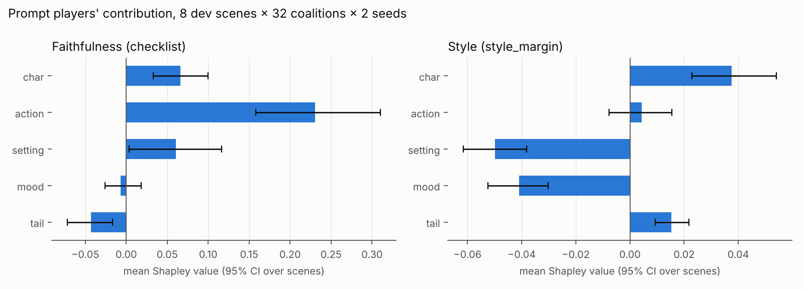

# SHAP attribution: which parts of a prompt matter

Tests hypotheses H-A4 to H-A6 (`experiments/HYPOTHESES.md` Section A).

- **Run:** 512 images, generated and scored on 18 Nov 2026 (git `173c6e6`; judge `Qwen/Qwen2-VL-2B-Instruct`).
- **Data:**
  - `results/shap@rrv_v1_dev.json` (per image)
  - `analysis/shap/shap_values_dev.json` (from `analysis/shap/shapley.py`)
  - `docs/figures/shap_dev.png`
- **Earlier numbers:** an earlier version of this file had attribution numbers with no images behind them
  (`eval/CLAIMS_AUDIT.md` §5). All of them were removed; everything below is new.

## 1. Game
- **Players:** five prompt parts, `char`, `action`, `setting`, `mood` and `tail`. Each is a name-free phrase of
  ≤ 14 words, written per scene in `analysis/shap/shap_scenes.json`.
- **Coalitions:** a coalition's prompt is the trigger plus its players in a fixed order
  (`analysis/shap/coalitions.py`). The empty coalition is the trigger alone.
- **Value v(S):** the score of coalition S's images, averaged over seeds 1-2. Every coalition uses the same seeds,
  so differences are not seed noise.
- **Metrics:** `checklist` for faithfulness (primary), `style_margin` for style, and `clip_raw` as a second
  faithfulness measure.
- **Scale:** 8 dev scenes, 2 per tier from 1 to 4 (s09, s10, s12, s27, s13, s21, s23, s31) × 32 coalitions ×
  2 seeds = **512 images**.
- **Computation:** exact Shapley values per scene. **The efficiency check (Σφ = v(all) − v(∅)) passed for every
  scene and metric.** Means are over scenes, with 95% bootstrap CIs over scenes.
- **Memorisation guardrail:** `max_train_dino` p95 0.817 (≤ 0.85).

For scale, mean `checklist` is 0.294 with the trigger alone and 0.602 with all five players. Mean `style_margin`
goes from 0.146 to 0.112 over the same change.

## 2. Shapley values

| Player | Mean tokens | φ `checklist` | φ `style_margin` | φ `clip_raw` |
|---|---|---|---|---|
| `char` | 16.9 | +0.066 [+0.033, +0.100] | **+0.038** [+0.023, +0.054] | +0.022 [+0.015, +0.031] |
| `action` | 12.8 | **+0.230** [+0.158, +0.310] | +0.004 [−0.008, +0.016] | **+0.062** [+0.046, +0.080] |
| `setting` | 9.0 | +0.061 [+0.004, +0.116] | −0.050 [−0.062, −0.038] | +0.022 [+0.001, +0.041] |
| `mood` | 7.3 | −0.007 [−0.026, +0.018] | −0.041 [−0.052, −0.030] | +0.003 [−0.004, +0.011] |
| `tail` | 9.0 | −0.043 [−0.072, −0.017] | +0.015 [+0.009, +0.022] | +0.002 [−0.002, +0.007] |

- **Faithfulness:**
  - The **action** is by far the most valuable part. It is worth more than `char` and `setting` combined, and the
    paired difference action − char is +0.164 [+0.078, +0.265], higher in 7 of 8 scenes.
  - `char` and `setting` add a similar, smaller amount: char − setting +0.005 [−0.061, +0.061].
  - `mood` adds nothing, and the style `tail` costs faithfulness.
  - `clip_raw` gives the same ranking.
- **Style:**
  - Only the character description (+0.038) and the tail (+0.015) raise `style_margin`.
  - The setting and mood phrases lower it (−0.050, −0.041), probably by pulling the image toward generic scenery.
    The trigger alone has the highest style score, at 0.146. The LoRA supplies most of the style, and scene detail
    dilutes it.

**By tier:** each tier has only 2 scenes, so these are descriptive only (`by_tier` in the values file).
- `action` has the largest faithfulness φ in every tier (0.19-0.28).
- `setting` matters most in tier 3 (+0.163), the multi-figure court and shore scenes.
- The tail costs the most in tier 4 (−0.107).

## 3. Interactions
Shapley interaction indices: > 0 means the two players work better together than apart.

| Pair | `checklist` | `style_margin` | `clip_raw` |
|---|---|---|---|
| `char × setting` | **+0.041** [+0.008, +0.071] | **+0.070** [+0.043, +0.098] | −0.004 [−0.024, +0.014] |
| `tail × mood` | +0.032 [−0.011, +0.075] | **+0.038** [+0.028, +0.047] | +0.005 [−0.004, +0.015] |

- **`char × setting` are complements.** A setting helps more when the characters are described, for both
  faithfulness and style. Adding the setting changes `style_margin` by −0.003 on average when `char` is already in the prompt, but by −0.059 when it is not, so its negative style φ comes from prompts without the characters.
- **`tail × mood`** complement each other for style, but not measurably for faithfulness.

## 4. Value per token
The faithfulness φ (`checklist`) per CLIP token of each player, from `value_per_token` in the values file.

| Player | Mean tokens | Faithfulness per token |
|---|---|---|
| `action` | 12.8 | **+0.0181** |
| `setting` | 9.0 | +0.0068 |
| `char` | 16.9 | +0.0039 |
| `mood` | 7.3 | −0.0010 |
| `tail` | 9.0 | −0.0048 |

Within a 70-token budget, the action is worth about 4.6 times as much per token as the character description, and
2.7 times as much as the setting. Mood and tail have negative value per token for faithfulness. This agrees with
the token-budget experiment (`pipeline/TOKEN_BUDGET.md`), where faithfulness peaked at character + action +
setting and fell when mood and tail were added.

## 5. Hypotheses
The pre-registered rule: a hypothesis is **supported** only if the 95% CI excludes 0 in the predicted direction.

| Hypothesis | Test | Result | Verdict |
|---|---|---|---|
| H-A4: `char` and `action` have the highest φ for faithfulness | Rank of mean φ (`checklist`), with paired differences over scenes | `action` is clearly first: action − char +0.164 [+0.078, +0.265]. `char` is second by mean, but not separable from `setting` (+0.005 [−0.061, +0.061]). | **Partly supported:** true for `action`; `char` is not distinguishable from `setting` |
| H-A5: `tail` > 0 for style, ≈ 0 or < 0 for faithfulness | φ_tail CIs | Style +0.015 [+0.009, +0.022]; faithfulness −0.043 [−0.072, −0.017] | **Supported** (the faithfulness effect is negative, not ≈ 0) |
| H-A6: names add ≈ 0 once descriptions are present | `with_names` − `full` (`pipeline/TOKEN_BUDGET.md`) | `checklist` −0.056 [−0.107, −0.012], lower in 6 of 8 scenes | **Not supported:** names lowered faithfulness |

## 6. Limits and what follows
- **Small sample:** 8 scenes and 2 seeds. The CIs are over scenes, so per-tier results (2 scenes each) are not
  evidence on their own.
- **Faithfulness is a proxy:** the 2B judge agrees with humans at ρ 0.41 on dev and 0.65 on held-out
  (`eval/EVAL_REPORT.md`). The SHAP images have no human ratings; the optional human-rated subset was not run.
- **Fixed wording and order:** each player is one hand-written phrase in a fixed order. Different wording, or
  putting the action first, could change the values.
- **For M4:**
  1. Spend the prompt on the **action**, then the setting and character.
  2. Drop the mood phrase.
  3. Treat the tail as a style option that costs faithfulness.
  4. Never add names.

  This is also why raw user text (c1), which is mostly character + action, held up so well against longer
  expansions.
