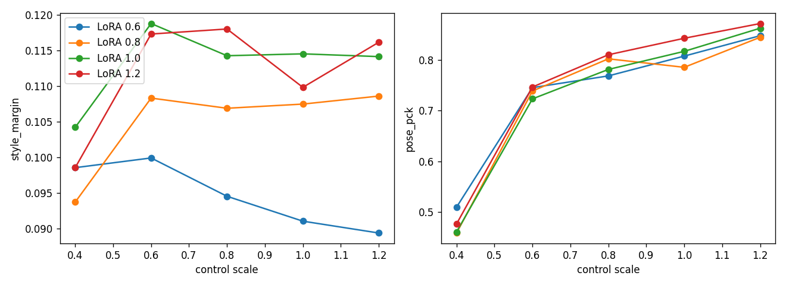

# Milestone 4 Report: Pose Control and a Usable Web App

**Team:** A (control engine, sweep), B (evaluation), C (pose inputs), D (app, post-processing, content policy;
assembles this report). **Assembled by:** D.

> **Rules for this file**
> - Every number comes from a file in `results/`, the rating sheets, or an owner's section file, and names its
>   source next to it. "Not tested" is an acceptable entry. No number is typed in from memory or from a chat.
> - Owners' sections are pasted, not rewritten: `CONTROL.md` (A) → §4, `POSE.md` (C) → §5, `APP.md` +
>   `CONTENT_POLICY.md` (D) → §6, `EVAL_REPORT_M4.md` (B) → §3, §7, §8.
> - `<<pending: owner, file>>` marks text still to come. Where two sections disagree, the owner is asked; nothing
>   is resolved silently.
> - B audits this file line by line before the `m4-v1.0` tag (`eval/CLAIMS_AUDIT_M4.md`).
> - **If pose control did not fix faces and hands, §7 says so in its first paragraph.**

---

## 1. Goal and system

**Goal.** A user types a scene from the Indian epics and can give a pose: a preset, a photo, or nothing. The app
returns a painting in Raja Ravi Varma's style. M4 adds **pose control (ControlNet)** and **a web app** to the M3
pipeline. It also tests the claim made since M2: *"faces and hands are our weak spot, and pose control is what we
plan to do about it."*

```
                          ┌───────────── [C] pose inputs ─────────────┐
 user text ─► M3 expand(text, "raw") ─► prompt    preset | photo | from-text | painting ─► ControlImage
                               │                                                              │
                               └─────────► [A] generate_controlled (SD1.5 + LoRA + ControlNet) ◄┘
                                                        │
                                       [D] post: hi-res / face restoration ─► [D] Gradio app + content policy
 [B] evaluates every stage: pose metric, blind ratings, stats, held-out     [A] sweeps the LoRA × ControlNet trade-off
```

**Where M1–M3 left us** (half a page; sources `docs/M3_REPORT.md`, `docs/HANDOFF_M4.md`):
- **M1–M2, the style model:**
  - a curated set of Raja Ravi Varma paintings (147 training images, 15 held-out paintings never trained on);
  - a LoRA on Stable Diffusion 1.5 (`rrv_v1`, the M2 winner `D_lr2e-4` at step 800) that knows Varma's *style*
    but not the *stories*.
- **M3, the text side:**
  - a parser and knowledge base, a prompt expander (template and local LLM), and a pre-registered evaluation.
  - **Main finding:** the user's own words with the LoRA (**c1**, raw text) were more faithful than every expanded
    prompt. Dev: c1 → full system (c3, the LLM + KB condition) −0.72 [−1.25, −0.25]. Held-out: −0.50 [−0.83, −0.17]. So c1 is the default
    pipeline, and M4 starts from it.
  - SHAP showed that the **action** phrase carries most of the faithfulness (φ +0.230).
  - Composition (wrong figure count + wrong action) was 25% of c1's main failures on dev and 46% on held-out. Pose
    control targets exactly that.
- **What M4 inherits unchanged:**
  - the c1 prompt `rrvarma style, <text>, oil painting, canvas texture, classical indian art`;
  - negative `ugly, blurry, bad anatomy`;
  - LoRA scale 1.0, DPM++ 2M, 30 steps, CFG 7.0, 512×512, all from `config/m3.json`.
  - There is no LLM anywhere in M4.

## 2. Research question and what is new since M3

**Research question.** *Does pose control fix what is wrong with our images (figure count, limbs, posture, faces,
hands), and what does it cost in style?*

**What is new:**
1. **A controlled ablation** on 16 scene + pose pairs (4 per member), plus 6 private held-out pairs (§3, §7):
   p0–p3, p5 and p6 were run; the optional p4, p7 and p8 were not. Every condition uses the same c1 prompt, so the
   pose (or the post-processing step, for p5/p6) is the only variable.
2. **A LoRA × ControlNet interaction sweep** (A): how pose strength trades against style strength, and the default
   chosen by a pre-registered rule (§4).
3. **A pose-source study** (C): a pose from a photo (p1) vs a pose made from the text alone (p3) (§5). Presets are in
   the app but were not rated.
4. **A post-processing study** (D): does hi-res or face restoration help faces, or does it wash out the painted
   look (§6)?
5. **A pose-adherence metric checked against blind human ratings,** with **faces and hands rated separately** (B,
   §8).
6. **A Gradio web app with a content policy:** an input blocklist, a visible "not an authentic work" label, upload
   deletion, and an output filter decided by measurement (§6).

**Proposal coverage, stated honestly:**
- **Posture:** covered by OpenPose body keypoints.
- **Gaze direction and drapery:** **not tested.**
- **Dignity and balance:** enter through the style-rating anchor.
- **Memory:** diffusion runs in **fp16**, not quantized (A's hardware table, §4). The quantization evidence is M3's
  4-bit local LLM.

## 3. Method
*Pasted from `eval/EVAL_REPORT_M4.md` §1 (B, #145/#146/#152) on 24 Nov.*

**Pairs.** 16 dev pairs (`eval/test_pairs_dev.json`): each is an M3 dev scene plus an OpenPose skeleton made from a
photo the team took of itself (photos deleted; skeletons only in git). Mix: 5 single-figure, 6 two-figure and
5 three-figure scenes; tiers 1/2/3/4 = 5/6/3/2. s22 has a `checklist_override` (its M3 item needed more than three
people). Held-out: 6 private pairs written by B (2 single, 2 two-figure, 2 three-figure), not opened before the
S3 decisions: all three were applied to dev ratings and recorded in `docs/TEAM_DECISIONS_M4.md` (#145) before the
held-out images were generated or scored; the held-out run is a check, not a tuning set (§7.7).

**Conditions** (16 pairs × seeds 1-2 = 32 images each; SD1.5 + `rrv_v1` LoRA 1.0, M3's c1 raw prompt, 512×512):

| Condition | What changes | Made by |
|---|---|---|
| `p0_m3_default` | M3 default, no control | A |
| `p1_openpose` | + OpenPose ControlNet, control 1.0, window 0-1.0 (baseline) | A |
| `p2_openpose_tuned` | + control 1.0, window 0-0.8 (A's rule winner, the app default) | A |
| `p3_pose_auto` | skeleton from the text (`pose_from_text`), baseline control | C |
| `p5_hires` | p1 + img2img hi-res to 768 (strength 0.35) | D |
| `p6_restore` | p1 + GFPGAN-class face restoration | D |

p4 (composition from a painting) and p8 (OpenPose with hands and face) were optional and not run; p7 and p9 were
not run either (`docs/TEAM_DECISIONS_M4.md` D5).

**Human ratings (main evidence).** Blind contact sheets: the pair's skeleton on the left, then the round's
conditions under random codes (`eval/contact_sheet_m4.py`). Four scores, 1-5, with written anchors
(`eval/RATING_GUIDE_M4.md`): style fidelity, pose match (to the skeleton), faces, hands ("NV" = not visible, not a
score; never used). Plus a failure box from the M4 taxonomy.
- Two rounds: sheet 1 = p0, p1, p2 (built 23 Nov); sheet 2 = p3, p5, p6 (built 24 Nov). Seed 1 only.
- 4 raters (A, B, C, D), 2 per image, each rating alone; 96 rows per round, all filled (192 ratings).
- Every image appears on the sheet at the same 320×320 tile size (downsized with Lanczos; p5's 768 images
  included), so resolution cannot unblind p5.
- **Deviation:** the planned 10-minute calibration (first 5 rows rated by all four, anchors reworded) was dropped
  to save time. The rows it would have produced were removed before rating; nobody rated a calibration row.

**Automated metrics (supporting).** `checklist` (M3's VLM judge, Qwen2-VL-2B; validated in M3, no M4 human
counterpart), `clip_raw`, `style_margin`, `max_train_dino` (M2 kit), and B's pose metric (`eval/pose_metric.py`):
`pose_pck` (PCK@0.10 of the control person's box diagonal, people matched by body centroid), `pose_detected`,
and figure count (`n_people_out` = `n_people_expected`).
- Limits: PCK is circular (the same detector family drew the photo skeletons); painted robes hide joints; for
  p3 PCK is scored against p3's own auto skeleton, not the pair pose; CLIP shares an encoder family with the
  generator; CLIP and DINO see resized images, so they cannot see hi-res gains.

**Statistics.** Unit = the pair (seed-1 image, two raters averaged). Paired differences b − a with 95% bootstrap CIs
over 16 pairs (5000 resamples) and win/tie/loss using the pre-registered tie bands: ratings 0.25, `pose_pck` 0.05,
`style_margin` 0.0295. No significance claims. A hypothesis is supported only if the CI excludes 0 in the
predicted direction.

**Hardware.** Generation and scoring on Colab Tesla T4 (14.6 GB), fp16, pins as in `docs/CONTROL.md`.

Hypotheses are pre-registered per owner in `experiments/HYPOTHESES_M4.md`. Each section's commit predates that
owner's first scored result (B confirms in the audit):
- **A**, H-A1–A5: control vs style knee, guidance window, LoRA above 1.0, p1 vs p0, p8.
- **B**, H-B1–B4: pose match and count, faces and hands, PCK validity, style cost.
- **C**, H-C1–C3: `pose_from_text` accuracy, p3 vs p1, the copy check.
- **D**, H-D1–D4: hi-res, face restoration vs style, the memorisation guardrail, app latency.

## 4. Control engine and the style/pose trade-off (A)
*Pasted from `docs/CONTROL.md` (A, #139, #149) on 24 Nov. Edit it there; this copy is refreshed at assembly.*

Final. Numbers trace to `results/`; human ratings are in B's `EVAL_REPORT_M4.md`.

### 4.1 What I built
`pipeline/control_api.py`: `generate_controlled(...)` runs SD1.5 + M3's Varma LoRA + one OpenPose ControlNet, derived from M3's own pipeline with `from_pipe`. The LoRA scale is set only through M3's `_ensure` (M2's `set_scale`), never `cross_attention_kwargs`. M3's `generate(..., control_image=X)` delegates to it.
`pipeline/run_batch.py` gained `--pairs`, `--control {none,openpose,openpose_full,canny}`, `--control_profile {baseline,tuned}`, `--control_source {pair,auto}` and the sweep-only `--control_scale --guidance_start --guidance_end --lora_scale`. `--condition` is mandatory and overrides the label in the prompt records. Manifests record the control settings, pose-file sha256, ControlNet revision, LoRA scale and negative used, config hashes and library versions.
Sweep: `pipeline/control_sweep.py` (generation) and `pipeline/control_score.py` (scoring, grids, plot).
Reproduce p1: see the pins block in the README (one `run_batch.py --control openpose --control_profile baseline` command per condition).

Pins: diffusers 0.40.0, transformers 5.17.0, peft 0.21.0, accelerate 1.15.0, controlnet_aux 0.0.10, gradio 6.31.0, torch 2.14.1+cu130; OpenPose ControlNet revision 9ae9f970358db89e211b87c915f9535c6686d5ba.
Sanity checks (one T4 session, all passed): scale 0 and LoRA 0.5/1.0 match M3 exactly (0.0/255, DINOv2 1.0); LoRA 0 differs from 1.0 by 41.4/255; a black control image runs; identical inputs give identical images.

### 4.2 Result
Stage 1 (3 fixtures x 2 seeds, 144 images; `results/control_stage1_cells.json`), LoRA 1.0 unless stated:

| control scale | pose_pck | style_margin |
|---|---|---|
| 0.4 | 0.461 | 0.1042 |
| 0.6 | 0.723 | 0.1188 |
| 0.8 | 0.781 | 0.1142 |
| 1.0 | 0.817 | 0.1145 |
| 1.2 | 0.862 | 0.1141 |
At LoRA 0.6, style_margin falls from 0.0999 (control 0.6) to 0.0894 (control 1.2); no other LoRA scale falls with control.

Window (control 1.0, LoRA 1.0), `guidance_end` 0.4 / 0.6 / 0.8 / 1.0: pose_pck 0.769 / 0.801 / 0.817 / 0.817; style_margin 0.111 / 0.122 / 0.118 / 0.115.
Per fixture, control 0.4 to 1.2: f01 0.25 to 0.89, f02 0.76 to 1.00, f03 0.38 to 0.70. In f03 the bent-over figure renders as a horse at every control scale. The detector found the expected number of people in 97 of 144 images.

Stage 2 (16 dev pairs, seed 1, against p0 seed 1; p0 style_margin 0.1101, eligibility floor 0.0806; all max_train_dino p95 <= 0.817):

| candidate | control / window / LoRA | pose_pck | style_margin |
|---|---|---|---|
| p1 baseline | 1.0 / 0-1.0 / 1.0 | 0.807 | 0.1070 |
| c0.8_l1.0 | 0.8 / 0-1.0 / 1.0 | 0.792 | 0.1038 |
| c1.2_l1.0 | 1.2 / 0-1.0 / 1.0 | 0.832 | 0.1029 |
| c0.8_l1.2 | 0.8 / 0-1.0 / 1.2 | 0.787 | 0.1069 |
| c1.0_ge0.8 | 1.0 / 0-0.8 / 1.0 | 0.809 | 0.1086 |

Rule outcome (Overview section 10): all five are eligible. c1.2_l1.0 has the top pose_pck, but its paired CI includes 0 against the baseline [-0.016, +0.069] and against c1.0_ge0.8 [-0.014, +0.066], so those three tie; the rule picks the lowest control scale among them, giving control.tuned = control 1.0, window 0-0.8, LoRA 1.0 (merged into config/m4.json, approved by D).
Hardware (Tesla T4, 14.6 GB, 512x512, 30 steps, fp16): baseline 6.19 GB, 19.4 s/image; attention slicing 6.19 GB, 23.4 s; model CPU offload 4.94 GB, 29.4 s; sequential offload 0.82 GB, 61.6 s; img2img 768 pass 7.07 GB, 18.5 s. With the ControlNet pipeline and the img2img pass both loaded, peak VRAM is 7.07 GB (measured end to end, 36.7 s per image for both passes), so SD + LoRA + ControlNet + hi-res fit one T4 with about 7.5 GB spare and no offloading.
p0 / p1 / p2 on 16 dev pairs x 2 seeds (automated metrics, quoted from `results/<condition>@rrv_v1_dev_pose.json`; human ratings are in B's report):

| condition | pose_pck | style_margin | checklist | clip_raw | max_train_dino p95 |
|---|---|---|---|---|---|
| p0_m3_default | 0.100 | 0.1082 | 0.565 | 0.277 | 0.807 |
| p1_openpose | 0.816 | 0.1016 | 0.587 | 0.270 | 0.811 |
| p2_openpose_tuned | 0.815 | 0.1026 | 0.594 | 0.271 | 0.818 |

Files behind these numbers (all in `results/`): `control_stage1_cells.json`, `control_stage1_pose_scores.json`, `control_rule_16pairs.json`, `control_stage2_<candidate>.json` (x4), `p0_m3_default@rrv_v1_dev_pose.json`, `p1_openpose@rrv_v1_dev_pose.json`, `p2_openpose_tuned@rrv_v1_dev_pose.json`.

### 4.3 What it means
- The pose knee is at control 0.6 to 0.8: f01 goes from 0.25 to 0.81 between 0.4 and 0.6.
- style_margin shows no clear cost of control: at LoRA 1.0 it spans 0.015 across control 0.4-1.2, half the 0.0295 tie band. Only LoRA 0.6 loses style as control rises.
- H-A1: the pose half held; the style half is not shown by this metric. H-A2: pose is unchanged at guidance_end 0.8 vs 1.0 (0.817 both) and style differs within the tie band, so neither supported nor refuted. H-A3: not supported; LoRA 1.2 gives no consistent style gain (control 1.0: 0.1098 vs 0.1145; control 1.2: 0.1161 vs 0.1141). H-A4 held: p1 beats p0 on human pose match (+1.59, 95% CI [+1.09, +2.03]) but is worse on faces (-0.44 [-0.78, -0.09]) and style (-0.28 [-0.53, -0.03]), with hands not distinguishable from zero (-0.25 [-0.56, +0.06]) (B's blind ratings, `eval/EVAL_REPORT_M4.md` section 2.2).
- On 16 pairs the tuned setting is indistinguishable from the baseline (pose_pck 0.809 vs 0.807, style 0.1086 vs 0.1070; identical on 8 of 16 pairs), and the three-way tie has CI edges of -0.016 and -0.014. Tuning gives no gain over the baseline; the 0-0.8 window costs nothing and gains nothing; p1 and p2 images differ by a median of 2.1/255 per pixel (`results/m4_p1_p2_similarity_dev.json`).
- c1.2_l1.0 has the highest pose match on 16 pairs (+0.025 over the baseline, CI includes 0), driven by s02 (+0.235) and s01 (+0.126), and it loses 0.1 or more on s18, s19 and s27, so it is not shown to be better.
- Slider help text (in the app, #137). Style strength (0.6 to 1.2, default 1.0): "How strongly the picture follows Varma's painted look. Lower numbers look more generic and glossy. 1.0 is the default. Going above 1.0 did not add more style in our tests." Pose strength (0.4 to 1.2, default 1.0): "How closely the figures follow your pose. Below about 0.6 they often ignore it. 0.8 to 1.0 follows it well. Above 1.0 adds little for simple poses. Unusual poses, such as bending right over, can be misread (in one test a bent-over figure turned into a horse)."

### 4.4 Limits
Stage 1 used 3 fixtures (f03 is dev scene s01, because M3's fixtures have no 3-figure scene) and 2 seeds, and only finds the region. Stage 2 used 16 pairs, one seed, bootstrap over 16 pairs. pose_pck uses the detector family that drew the skeletons (circular), and painted figures are hard to detect, so human pose-match ratings are the main evidence. style_margin measures similarity to Varma references and cannot see stiffness, faces or hands. One base model (SD1.5, 512x512), fp16 not quantized, hardware on one T4. Gaze and drapery were not tested.

### 4.5 For the report's Q&A
- Does ControlNet fix faces? No: p0 to p1 changes faces by -0.44 [-0.78, -0.09] and hands by -0.25 [-0.56, +0.06] in B's blind ratings (`eval/EVAL_REPORT_M4.md` section 2.2), i.e. faces get slightly worse, not better. Body-only OpenPose carries only coarse head keypoints and does not target faces.
- Why this pose strength? Pose match rises steeply up to control 0.6-0.8 and flattens after 1.0 (stage 1: 0.46 to 0.72 to 0.82 to 0.86 at 0.4, 0.6, 1.0, 1.2). On 16 pairs, 1.2 is not shown to beat 1.0 (paired CI against the baseline [-0.016, +0.069]) and style_margin does not fall at any tested setting, so we keep 1.0 and the rule's 0-0.8 window, which costs nothing.
- Does the style survive? Mostly by the automated metric, less so to human raters. style_margin stays within the tie band at every tested setting, but blind raters score p1 lower on style than p0 (-0.28 [-0.53, -0.03]), and style_margin and human style correlate only 0.17 (B), so the metric cannot be relied on to detect this loss.

**Figure:** the style/pose trade-off from stage 1 (`docs/figures/tradeoff.png`). The stage-1 grids are on A's Drive (`m4/sweep/stage1_results/`).



## 5. Pose inputs and the copy check (C)
`<<pending: C, POSE.md>>`: the renderer, the preset library, `pose_from_text` accuracy (H-C1), photo extraction
robustness, p3 vs p1 (from B's tables), and p4 with the copy check, if it ran.

## 6. App, post-processing and content policy (D)
*Pasted from `docs/APP.md` and `docs/CONTENT_POLICY.md` on 24 Nov.*

### 6.1 App and post-processing (`docs/APP.md`)
Updated 24 Nov 2026 with B's dev ratings. Anything marked `<<pending: ...>>` has not been measured yet; no number in this file is
estimated. Files in `results/` are the source for every metric.

#### 1. What I built
**The panel** (`app/app.py`, Gradio): scene text + pose mode (none / preset / upload photo / auto from text) + style
slider (LoRA scale) + pose slider (control scale) + seed + post-processing checkboxes. Outputs: the painting (with the
content label), the skeleton, the prompt and parsed characters, and a settings JSON. The prompt is M3's c1 raw prompt,
so no LLM is loaded. The model is loaded once at launch, one job runs at a time (queue), and every failure (empty or
over-long text, blocked prompt, no person in a photo, out of memory) gives a friendly message, not a traceback.
Defaults and slider ranges come from `config/m3.json` and `config/m4.json` (currently style 0.6–1.2, pose 0.4–1.2, the
ranges A's sweep covered).

**Post-processing** (`post/`):
- *Hi-res (p5):* Lanczos 512→768, then SD img2img at strength 0.35 with the same weights, LoRA, prompt and negative
  (`from_pipe`, so the LoRA state is shared).
- *Face restoration (p6):* GFPGAN 1.3 (`post/restore.py`).
- ESRGAN ×2 is implemented (`--method hires_esrgan`) but **was not run**, so it is not evaluated (cut list, Overview §14).

```
python app/app.py --share --auth user:password
python post/run_post.py --manifest $IMG/p1_openpose@rrv_v1/dev/manifest.json --condition p5_hires --method hires_img2img --out $IMG/p5_hires@rrv_v1/dev
python post/run_post.py --manifest $IMG/p1_openpose@rrv_v1/dev/manifest.json --condition p6_restore --method restore_gfpgan --out $IMG/p6_restore@rrv_v1/dev
```
Versions (Colab T4, Python 3.13): torch 2.14.1+cu130, diffusers 0.40.0, gradio 6.31.0, gfpgan 1.3.8, basicsr 1.4.2
(pins in `post/requirements_post.txt`). GFPGAN does not install on Python 3.13 with plain `pip`; `post/install_post.sh`
builds a patched basicsr from source. **Screenshots** (dev scenes only, 23 Nov, on a phone over mobile data through the public link with `--auth`), on Drive `m4/demo/`: three paintings of one scene (recorded on 23 Nov as text only, style 0.6 and style 1.2); one run with preset mode on but no preset picked, so no pose was used; a blocked prompt; and a failed run (TypeError; probably the scale bug fixed later in #140). **No screenshot in that folder shows a working preset or uploaded-photo pose** (A's S2 check, Status issue 17, 24 Nov, has a preset one), and none shows a photo of a person. `<<pending: D, retake the preset and uploaded-photo shots on main after #140>>`. Drive link: https://drive.google.com/drive/folders/1lWFiRzGHe-4JRSgDlchg0xX0xRCYOhSr

#### 2. Result
**Post-processing time on a T4** (post step only; excludes the base image). Source: `results/post_timing_dev.json` (all 32 images; from D's p5/p6 manifests on Drive); the end-to-end app numbers below are in `results/app_latency.json`:

| step | median per image | note |
|---|---|---|
| p5 hi-res (img2img 768, 10 steps) | 17.3 s | slowest 48.6 s (probably model load) |
| p6 face restoration (GFPGAN) | 0.84 s | slowest 12.1 s (model load) |

**End-to-end latency and peak VRAM** (`results/app_latency.json`; Tesla T4, torch 2.14.1+cu130; through the app's
own handler, so policy, parsing, prompt, pose, generation, post-processing, label and PNG save are all included; scene
"Hanuman kneeling before Rama and offering him Sita's ring"; tuned pose profile; median of 5 warm runs):

| configuration | median | min-max | peak VRAM |
|---|---|---|---|
| text only (no pose) | 5.95 s | 5.64-6.23 s | 2.62 GB |
| + preset pose (kneeling, ControlNet) | 22.53 s | 22.33-22.67 s | 6.18 GB |
| + hi-res (img2img 768) | **40.34 s** | 40.05-40.63 s | 7.07 GB |
| + hi-res + face restoration | 40.76 s | 40.55-41.51 s | 7.58 GB |

- **Cold start:** 39.0 s. That covers loading the app's models from the disk cache plus the first image; a brand-new
  runtime adds the model download (not measured).
- **Hi-res cost:** about 17.8 s on top of the pose image. Face restoration adds about 0.4 s.
- **Memory:** everything fits one T4 (14.6 GB) at once, with no offloading. This matches A's hardware table.
- **H-D4 (text + pose + hi-res under 60 s): supported** (40.3 s).

**Automated scores, p5 and p6** (M3 metrics; `results/p5_hires@rrv_v1_dev.json`, `results/p6_restore@rrv_v1_dev.json`;
all 16 dev pairs × 2 seeds, rescored 23 Nov with `--pairs`; p1 for reference from `results/p1_openpose@rrv_v1_dev.json`):

| | checklist | style_margin | clip_raw | max_train_dino mean / p95 |
|---|---|---|---|---|
| p1 (reference: `results/p1_openpose@rrv_v1_dev.json`) | 0.587 | 0.102 | 0.270 | 0.688 / — |
| p5 hi-res | 0.571 | 0.094 | 0.272 | 0.696 / 0.815 |
| p6 restore | 0.587 | 0.102 | 0.270 | 0.689 / 0.810 |

p5 and p6 are made from D's own p1 base run (`run_batch.py`, baseline profile, the same prompts and seeds). B checked s09 seed 1: D's base image is byte-identical to A's rated p1 image (sha256 `8d63f5db…`, `docs/TEAM_DECISIONS_M4.md` D2), so p1 → p5/p6 compares the same base (compared with A on one image; the same code, settings and seeds produced the rest). All 32 p5 and 32 p6 rows record a `source_sha256` that matches D's p1 base file (`results/post_timing_dev.json`). Paired comparisons with CIs are in `eval/EVAL_REPORT_M4.md`. Read as means only:
- p6 matches p1 on every automated metric. GFPGAN changes only the face region, which these whole-image metrics
  barely see.
- p5 is slightly lower on checklist and `style_margin`. This is consistent with img2img redrawing details.

H-D3 (`max_train_dino` p95 ≤ 0.85): **holds for both** on 16 pairs (0.815 and 0.810). **CLIP and DINO see a resized image, so they cannot
show resolution gains.** The question "do these steps help faces?" is answered by B's blind face, hand and style ratings
(`eval/EVAL_REPORT_M4.md` §2.2, `results/m4_tables_dev.md`) and by the face-crop strips (`docs/figures/post_face_strips.png`, `post/face_strips.py`: s09, s19 and s31, seed 1, p1 | p5 | p6, crops centred on the control skeleton's head; not blind).

**Blind ratings, p1 → p5 / p6** (paired over 16 pairs, seed 1; `docs/TEAM_DECISIONS_M4.md` D2, `results/m4_tables_dev.md`):

| p1 → | faces (rule: > +0.25) | hands (rule: ≥ −0.25) | style (rule: > −0.3) | passes rule 2 |
|---|---|---|---|---|
| p5 hi-res | +0.31 [+0.12, +0.53] | +0.25 [+0.00, +0.50] | −0.03 [−0.25, +0.22] | **yes** |
| p6 face restore | +0.19 [+0.00, +0.34] | +0.25 [+0.09, +0.41] | +0.12 [−0.06, +0.31] | no (faces) |

**What is on by default** (Overview §10 rule 2, applied at S3):
- **Hi-res** passes the rating test, but not the spot check. D's spot check (24 Nov, T4; s09, s19, s27, s31, seed 1) found visible new artifacts, so by the rule hi-res stays an **opt-in checkbox** and `post.default_on` stays `false`. s09: dark marks on the toes, and the resting hand loses its fingers. s27: specks on the child's chest, and the child's foot becomes hand-like. s19 and s31 showed no clear new artifact (s19's faces improved; s31's bottom-left hand looked softer but was not examined closely). No figure was duplicated. The four p2 images were regenerated with the tuned profile and were not compared with A's files; the check was by eye, not blind, read from the notebook output by Claude, and the opt-in decision was D's. B's held-out run agrees: p1 → p5 faces −0.08 [−0.42, +0.25], which would not pass the rule (`docs/TEAM_DECISIONS_M4.md` D7).
- **Face restoration** stays an opt-in checkbox.

**Caveats (B):** faces passed by 0.06, while two raters scoring the near-identical p1/p2 images already differ by
0.25 on faces. Hands agreement is low (weighted kappa 0.14). p1 and p5/p6 were rated in different rounds.

**Uploads:** deleted when the request finishes, and **within N = 6 minutes** in any case. The Gradio temp path is `/tmp/gradio` (Gradio's default; `GRADIO_TEMP_DIR` overrides it). Normal case: no copy left at the first check after the response. If the handler never deletes it, Gradio's timer removed it after 360 s. (`results/app_upload_cache.json`, `results/app_upload_cache_timer.json`; measured 23 Nov with the app's real Gradio layer and handler on the pinned Gradio 6.31.0, image generation stubbed on CPU).

#### 3. What it means
**First look by eye, before any ratings** (face-crop strips for s09, s19 and s31, plus a few full images). This is
not a rating, and B's blind ratings decide:
- img2img changes faces, not just sharpens them: at strength 0.35 some nose, mouth and eye shapes differ from the base.
- GFPGAN keeps the layout but makes faces smoother and brighter, which is the "less painted" effect H-D2 predicts.
- Faces already distorted in the base (half-hidden or asymmetric) stay distorted after both steps.
- In the strips:
  - **Hi-res redraws the face.** s19's mask-like eyes become cleaner and more natural, s09's eyes and nose change shape,
    and s31 gains detail in the crown.
  - **Restoration barely moves the layout** but smooths the skin and sharpens the eyes (most visible on s31).
  - So hi-res can *repair* a face by redrawing it, but it can also change a face that was fine. Restoration is a
    lighter touch that leans photographic.

**What the blind ratings say** (the table in §2):
- **H-D1 (hi-res improves detail without duplicating figures):** faces improve slightly (+0.31), just past the bar, and
  style holds (−0.03). **Duplicated figures did not increase:** "merged/duplicated figures" was ticked 4 times for both p1 and p5 out of 32
  ratings, and nobody ticked "post-processing artifacts" (`eval/EVAL_REPORT_M4.md` §2.5). So H-D1 holds on these
  ratings, narrowly. The eye-ball note above (hi-res can repair a face by redrawing it) is consistent with this small
  gain.
- **H-D2 (restoration raises faces but lowers style):** not supported as predicted. Faces rose only +0.19 (under the
  bar), and style did not drop (+0.12, CI includes 0). "Style weakened (photographic)" was ticked twice for both p1 and p6.
- **Neither step fixes faces or hands in a large way.** The largest face gain (+0.31) is about the size of the
  rater-to-rater noise (0.25), and it did not replicate on the held-out pairs (−0.08).

#### 4. Limits
- Native resolution is 512 (SD1.5). Hi-res is upscale-then-refine, not a true 768 generation.
- p5 and p6 were first run on 12 of the 16 dev pairs, because C's four pairs merged later. On 23 Nov the base images
  were completed and all 16 pairs were scored.
- n is small (12–16 pairs, 2 seeds): no significance claims.
- CLIP and DINO cannot see resolution gains; hi-res detail is judged on crops and is not blind.
- ESRGAN was not run. GFPGAN was tested on SD paintings only. A face was found in 31 of 32
  p6 images; `s25_s2` (a leaping figure) had none (`results/post_timing_dev.json`).
- Free Colab: one GPU session, one job at a time, the session can time out, and the public link dies with it.
- **Photo poses are not live yet:** `extract_pose` on `main` is C's stub, so any uploaded photo gives a fixed standing
  figure (the app says so). p1's photo skeletons came from `eval/make_pair_pose.py`, not from this path.
- Uploads pass through Gradio's temporary cache, and the link goes through Gradio's relay.
- The output NSFW filter is a soft blur-and-confirm backstop (`app/nsfw.py`, `docs/CONTENT_POLICY.md` §5). It sits
  at the boundary of B's audit (1 of 15 real paintings flagged, a false positive), so it will blur some innocent
  paintings, and its flag rate on our own outputs is not measured. The pose and the filter were exercised with fakes on
  CPU; the live GPU run is the S2 check.

#### 5. For the report's Q&A
**Can a user generate harmful content?** The input blocklist and category lexicon refuse sexualised or nude depictions,
demeaning depictions of deities, hateful content, real named living people and gore, and every image is labelled. It is a
blocklist: paraphrases, misspellings and other languages can get through. The output passes a soft NSFW blur-and-confirm
filter (§4, `docs/CONTENT_POLICY.md` §5). There is no human moderation (`docs/CONTENT_POLICY.md` §7).

**Where do uploads go?** A photo is meant only for extracting a skeleton (still a stub, §4) and is deleted by the app as soon as the skeleton
exists (measured: no copy left when the request finished). If that ever fails, Gradio's own timer removes it; measured at 360 s, so the app
promises deletion within 6 minutes. We do not claim they
are "not saved".

**Is this a Ravi Varma?** No. The images are *in the style of*, not by, Raja Ravi Varma. They carry that label on the image
and in the file metadata, and are for research and coursework only.

### 6.2 Content policy (`docs/CONTENT_POLICY.md`)
**What this covers:** what the app (`app/app.py`) will and won't make, how that is enforced, and what is still
open.

**Status:** N is measured (§4). The NSFW decision (§5) and the link access (§6) are recorded in their sections.

#### 1. Allowed
- Scenes from the epics and the Puranas, including **non-graphic** battles.
- Devotional, courtly and domestic subjects in the manner Raja Ravi Varma painted.
- Deities and epic figures shown **respectfully**: dignified, balanced and fully clothed in the period's dress.

#### 2. Blocked at input
The checks are deterministic: `app/policy.py` with `app/blocklist.json`.

| Category | Examples refused | Message to the user (shortened) |
|---|---|---|
| Sexual / nude | "nude", "naked", "lingerie", "sexy"; "seductive" or "sensual" next to a deity or epic figure | doesn't make sexualised or nude images of anyone, especially deities |
| Demeaning | "cartoon", "meme", "clown", "drunk", "holding a gun" next to a deity or epic figure | depicts deities respectfully; a respectful version is fine |
| Hateful | hate symbols and slogans; desecration next to a figure | doesn't make hateful content about any group or faith |
| Gore | "decapitated", "disembowelled", "entrails", "pool of blood" | battles are fine, gore isn't |
| Real living people | named politicians, actors, sportspeople, business leaders | doesn't depict real, named living people |

**How the matching works:**
- **Two texts are checked:** the user's text and the final positive prompt. The negative prompt is not checked,
  because M3's negative contains "ugly" on purpose.
- **Matching:** whole words or phrases, case- and accent-insensitive.
- **Words that depend on context** ("cartoon", "seductive") block only within 6 words of a name from M3's
  `kb/names.json` (559 deities and epic figures). So "a cartoon of a mountain" is allowed, and "Ganesha as a
  cartoon" is not.
- **Refusals** are one calm, specific sentence, never a lecture.
- **Tests:** `tests/test_app_policy.py` has 21 allowed and 20 blocked examples, including borderline ones. They run
  in CI.

**Decision: Draupadi's disrobing (*vastraharan*) is allowed.**
- **What is allowed:** the episode as Varma painted it. Draupadi is fully clothed, and Krishna's endless sari
  protects her.
- **Why:** it is a central scene of the Mahabharata and part of Varma's own subject list. Refusing it would refuse
  the epic itself, not harmful content.
- **How:** the episode's name (`allowed_despite_terms` in `app/blocklist.json`) never triggers a block on its own.
  Any sexual or nudity term in the same text still does ("Draupadi's disrobing, naked …" is refused).
- **Related:** "Draupadi humiliated in the dice hall" is allowed for the same reason.

#### 3. Labelling
- **On screen and in downloads:** every image the app shows or offers for download has a caption bar: *"AI-generated
  in the style of Raja Ravi Varma. Not an authentic work."*
- **In the file:** the PNG metadata holds the same text (`Description`) plus the app version and every setting:
  model, seed, LoRA scale, pose mode, control scale and post-processing (`parameters`). So any download can be
  reproduced and identified.
- **Evaluation images are never labelled.** They are made by `run_batch.py`, not the app, so the metrics and raters
  see the raw image.

#### 4. Uploads
- **Purpose:** a photo is used only to extract a stick-figure skeleton (C's `extract_pose`, which writes nothing; still a stub on
  `main`, so the photo's pose is not read yet).
- **Deletion:** the app deletes the uploaded file in its handler as soon as the skeleton exists, including when the
  prompt is refused. Gradio's own upload cache is cleared on a timer (`delete_cache`).
- **Measured N = 6 minutes** (`results/app_upload_cache.json`, `results/app_upload_cache_timer.json`; measured 23 Nov with the app's real Gradio layer and handler on the pinned Gradio 6.31.0, image generation stubbed on CPU):
  - **Normal case:** no copy of the upload was left under Gradio's temp folder (`/tmp/gradio`) when the request
    finished. The handler deletes Gradio's copy itself.
  - **If the handler never deletes it** (for example a crash before the pose step), Gradio's own `delete_cache`
    timer (sweep every 60 s, age 300 s) removed it after **360 s**.
  - **A control upload** to a handler that does not delete stayed in `/tmp/gradio` until that timer, so the check
    looked in the right place.
- **The app tells the user,** next to the upload box: the photo is used only for the pose and deleted when the
  request finishes, and in any case within 6 minutes. **Nothing says "not saved".**
- **Canny (edge) uploads are not offered for photos of people,** because edges carry a person's silhouette. Painting
  uploads also stay off: p4 (composition from a painting) was not run (`docs/TEAM_DECISIONS_M4.md` D5), so
  there is no evidence about whether it copies the painting.

#### 5. Output NSFW filter
- **Measurement (B, `results/audit_real_paintings.json`, run 22 Nov 2026):** classifier
  `Falconsai/nsfw_image_detection`, threshold 0.5, on the 15 real held-out Varma paintings: **1 of 15 flagged**
  (`varma_suckling_child_a52.png`, score 0.994: a mother nursing a child, a classic false positive on classical
  painting). The other 14 scored below 0.01.
- **Rule, fixed in advance:**
  - more than 1 of 15 real paintings flagged → **don't enable** the filter, and rely on the input blocklist and the
    label;
  - otherwise → a soft blur-and-confirm filter, not a hard block.
- **Decision:** 1 is not more than 1, so by the rule the filter is **enabled as a soft blur-and-confirm** on app
  output only: a flagged image is shown blurred with a "Show image" button, never blocked, and never applied to
  evaluation images.
- **Caveats, stated plainly:**
  - the result sits exactly on the boundary, and the one flagged painting is a false positive of the kind the M2
    safety checker also produced, so expect the blur to fire on some innocent images (nursing, bathing, drapery);
  - the measurement on our own generated outputs is not in the audit file (`extra` is empty), so the flag rate on
    our images is not measured;
  - the filter is a backstop, not the main control: the input blocklist and the label do the real work.
- **Status: implemented** (`app/nsfw.py`, wired in `app/app.py`). `Falconsai/nsfw_image_detection` runs on CPU
  (loaded on first use, so it does not compete for T4 memory), threshold 0.5 as in the audit. A flagged image is
  shown blurred with the label, the status line says why, and a **Show image** button reveals the unblurred copy.
  The downloadable file stays the blurred one. `APP_NSFW=0` switches it off; if the model cannot load the filter
  stays off and the reason is written to the server log. The settings JSON records `nsfw_flagged`.
  **Not measured:** the flag rate on our own generated images (only the 15 real paintings were audited).
- **Background:** the M2 safety checker stays off, because it false-blocked classical paintings.

#### 6. Public link
- **Access (decision, 22 Nov):** the public link is launched with `--auth user:password`, and the password is shared
  only with the class and the markers. The link is shared only while demoing or testing, and the Colab session is
  closed afterwards (the link dies with it).
- **Why it matters:** the link goes through Gradio's relay and dies with the Colab session. Anyone who has it can use
  our GPU quota.

#### 7. Known gaps
- **A blocklist can't catch everything:** paraphrases, misspellings, other languages and new names get through.
- **There is no human moderation,** and no output classifier unless §5 enables one.
- **The living-people list is short and illustrative,** not complete.
- **The images themselves are not checked for respectful depiction.** That rests on the input rules, the
  respectful presets (C) and the label.

#### 8. Model card note (shown in the app's About text)
Research and coursework use only. Outputs are *in the style of*, not *by*, Raja Ravi Varma, and are never to be
passed off as authentic works. Not for demeaning or sexualised depictions of deities or anyone else.

## 7. Results (B)
*Pasted from `eval/EVAL_REPORT_M4.md` §2–§3 (B, #152) on 24 Nov. Dev and held-out results are final.*

**The short answer.** ControlNet fixes posture, not faces or hands. Adding OpenPose control (p0 → p1) raised human
pose match by +1.59 points (1-5 scale; 95% CI [+1.09, +2.03], better on 14 of 16 pairs), but faces got **worse**
(−0.44 [−0.78, −0.09]) and hands did not improve (−0.25 [−0.56, +0.06]). The tuned setting the app uses (p2)
produces near-identical images to p1 (median pixel difference 2.1 of 255), so it does not change this. Hi-res
post-processing (p5) is the one step that lifted faces past our 0.25 bar (+0.31 [+0.12, +0.53] over p1) without
costing style, but only just: two raters scoring the same p1/p2 images already differ by 0.25 on faces (§8).
Face restoration (p6) helped less (+0.19). Hands ratings are the least reliable score we collected (rater
agreement kappa 0.14), so read every hands number as weak.

**Held-out check (6 private pairs, §7.7).** Posture result held: supplied pose +1.75 pose match, auto-from-text −1.58 vs a
photo pose, tuned window no different. Two dev findings did **not** replicate: control did not measurably hurt faces
(+0.17, CI includes 0), and hi-res did not lift faces (−0.08 [−0.42, +0.25]; dev +0.31), so the hi-res default is
kept off (`TEAM_DECISIONS_M4.md` D7).

### 7.1 Means per condition
Pair means (seed 1, raters averaged) with 95% CIs. Figure count = share of images with the right number of people.

| Condition | style | pose match | faces | hands | `pose_pck` | figure count | `style_margin` | checklist |
|---|---|---|---|---|---|---|---|---|
| p0 | 3.66 [3.44, 3.88] | 2.12 [1.78, 2.50] | 3.31 [3.06, 3.53] | 2.97 [2.75, 3.19] | 0.10 | 0.53 | 0.11 | 0.56 |
| p1 | 3.38 [3.19, 3.56] | 3.72 [3.47, 3.94] | 2.88 [2.69, 3.06] | 2.72 [2.50, 2.94] | 0.82 | 0.81 | 0.10 | 0.59 |
| p2 | 3.47 [3.25, 3.69] | 3.88 [3.66, 4.09] | 3.12 [2.81, 3.44] | 2.88 [2.62, 3.12] | 0.82 | 0.84 | 0.10 | 0.59 |
| p3 | 3.00 [2.78, 3.22] | 1.78 [1.56, 2.03] | 2.75 [2.53, 2.97] | 3.00 [2.75, 3.22] | 0.93* | 0.88 | 0.12 | 0.50 |
| p5 | 3.34 [3.12, 3.56] | 3.72 [3.53, 3.88] | 3.19 [2.91, 3.47] | 2.97 [2.78, 3.16] | 0.82 | 0.84 | 0.09 | 0.57 |
| p6 | 3.50 [3.31, 3.69] | 3.81 [3.66, 3.97] | 3.06 [2.84, 3.28] | 2.97 [2.72, 3.22] | 0.81 | 0.81 | 0.10 | 0.59 |

\* p3's `pose_pck` is against its own auto skeleton, so it is not comparable with the other rows.
`max_train_dino` p95 (memorisation flag ≤ 0.85), both seeds: p0 0.807, p1 0.811, p2 0.818, p3 0.771, p5 0.815,
p6 0.810. No condition is flagged.

### 7.2 Paired comparisons
b − a, 95% CI, (win/tie/loss over 16 pairs).

| Comparison | style | pose match | faces | hands | `pose_pck` |
|---|---|---|---|---|---|
| p0 → p1 | −0.28 [−0.53, −0.03] (3/5/8) | **+1.59 [+1.09, +2.03] (14/1/1)** | **−0.44 [−0.78, −0.09] (4/2/10)** | −0.25 [−0.56, +0.06] (5/3/8) | +0.72 (16/0/0) |
| p1 → p2 | +0.09 [−0.16, +0.31] (6/7/3) | +0.16 [−0.03, +0.34] (8/5/3) | +0.25 [+0.03, +0.47] (9/4/3) | +0.16 [−0.06, +0.38] (6/7/3) | −0.00 (0/16/0) |
| p0 → p2 | −0.19 [−0.53, +0.19] (4/3/9) | **+1.75 [+1.25, +2.22] (14/2/0)** | −0.19 [−0.62, +0.19] (6/3/7) | −0.09 [−0.38, +0.22] (4/5/7) | +0.71 (16/0/0) |
| p1 → p3 | −0.38 [−0.75, +0.00] (3/4/9) | **−1.94 [−2.25, −1.59] (0/0/16)** | −0.12 [−0.41, +0.16] (3/6/7) | +0.28 [−0.03, +0.56] (9/2/5) | n/a* |
| p1 → p5 | −0.03 [−0.25, +0.22] (4/7/5) | +0.00 [−0.19, +0.19] (3/9/4) | **+0.31 [+0.12, +0.53] (8/7/1)** | +0.25 [+0.00, +0.50] (6/8/2) | +0.01 (2/13/1) |
| p1 → p6 | +0.12 [−0.06, +0.31] (5/9/2) | +0.09 [−0.12, +0.31] (6/6/4) | +0.19 [+0.00, +0.34] (8/6/2) | +0.25 [+0.09, +0.41] (8/7/1) | −0.00 (0/16/0) |

**p1 → p2 compares near-identical images** (§8): the window change alters the last 20% of the steps only, and the
two images differ by a median of 2.1 of 255 per pixel. Its rating differences measure rater noise, not the setting.

**Read with care:** p1 was rated in round 1 and p3/p5/p6 in round 2, on different sheets and days. Comparisons
across rounds (p1 → p3, p5, p6) include any shift in how raters used the scale between sessions; comparisons inside
a round (p0, p1, p2) do not.

### 7.3 By tier and by people count (human ratings)
Pairs per tier: t1 5, t2 6, t3 3, t4 2; by people: 1 = 5, 2 = 6, 3 = 5. CIs on 2-6 pairs are very wide.

| p0 → p1 | pose match | faces | hands | style |
|---|---|---|---|---|
| tier 1 (n=5) | +2.10 [+1.50, +2.70] | −0.30 [−0.70, +0.20] | −0.70 [−1.10, −0.30] | −0.30 [−0.70, +0.10] |
| tier 2 (n=6) | +1.33 [+0.50, +2.00] | −0.75 [−1.17, −0.25] | −0.42 [−0.83, +0.00] | −0.50 [−0.83, −0.17] |
| tier 3 (n=3) | +1.67 [+0.50, +2.50] | +0.33 [+0.00, +0.50] | +0.50 [+0.50, +0.50] | +0.33 [+0.00, +0.50] |
| tier 4 (n=2) | +1.00 [+0.00, +2.00] | −1.00 [−1.50, −0.50] | +0.25 [+0.00, +0.50] | −0.50 [−1.00, +0.00] |
| 1 person (n=5) | +2.10 [+1.50, +2.70] | −0.30 [−0.70, +0.20] | −0.70 [−1.10, −0.30] | −0.30 [−0.70, +0.10] |
| 2 people (n=6) | +1.33 [+0.50, +2.00] | −0.75 [−1.17, −0.25] | −0.42 [−0.83, +0.00] | −0.50 [−0.83, −0.17] |
| 3 people (n=5) | +1.40 [+0.50, +2.20] | −0.20 [−0.90, +0.40] | +0.40 [+0.20, +0.50] | +0.00 [−0.50, +0.40] |

| p1 → p3 pose match | tier 1 | tier 2 | tier 3 | tier 4 |
|---|---|---|---|---|
| | −2.50 (0/0/5) | −1.83 (0/0/6) | −1.33 (0/0/3) | −1.75 (0/0/2) |

The mean pose-match gain is positive at every tier and people count. The face cost is clearest in 2-person scenes
(−0.75 [−1.17, −0.25]); in 3-person scenes faces are level and hands slightly better (+0.40 [+0.20, +0.50]). Per-tier rows for p1 → p2 and the people-count rows
for p1 → p3 are in `results/m4_tables_dev.json`.

### 7.4 Figure count (seed 1, from `results/m4_extras_dev.json`)
Right number of people: p0 9/16, p1 13/16, p2 13/16, p3 15/16, p5 13/16, p6 13/16.
- p0 → p1: only p1 right on 5 pairs, only p0 right on 1. In tiers 2-4 (11 pairs): 8 vs 5 right (4 vs 1).
- p0 → p3: only p3 right on 6 pairs, only p0 right on 0.

### 7.5 Faces and hands, and the failure taxonomy
Faces and hands are separate scores throughout; neither is merged into an "anatomy" number. Failure-box ticks
over 32 ratings per condition (2 raters × 16 pairs; a rating can tick several boxes):

| Failure | p0 | p1 | p2 | p3 | p5 | p6 |
|---|---|---|---|---|---|---|
| pose ignored | 16 | 2 | 2 | 27 | 0 | 0 |
| pose followed but scene wrong | 0 | 5 | 5 | 0 | 8 | 10 |
| face distorted | 0 | 9 | 10 | 7 | 8 | 8 |
| hands malformed | 3 | 5 | 5 | 1 | 1 | 4 |
| merged/duplicated figures | 5 | 4 | 5 | 2 | 4 | 3 |
| extra/missing limbs | 2 | 2 | 2 | 0 | 3 | 3 |
| style weakened (photographic) | 0 | 2 | 1 | 1 | 1 | 2 |
| stiff/over-constrained | 0 | 1 | 1 | 3 | 1 | 1 |
| post-processing artifacts | 0 | 0 | 0 | 0 | 0 | 0 |
| other | 1 | 2 | 1 | 0 | 2 | 1 |

(p3's "pose ignored" includes one entry typed with a double space, merged here.) "Face distorted" appears only once
control is on (0 → 9), matching the face ratings. Nobody ticked "post-processing artifacts" for p5 or p6.

### 7.6 Comparison grids
Seed-1 images cut from the blind contact sheets and labelled after unblinding (`eval/grids_m4.py`), each row:
control skeleton | p0 | p1 | p2 | p3 | p5 | p6, with the two raters' mean style / pose / faces / hands. Failures are
included on purpose.

| Grid | Why it was picked |
|---|---|
| `docs/figures/grid_m4_dev_s02.png` | largest pose-match gain with control (p0 → p1 +3.0) |
| `docs/figures/grid_m4_dev_s11.png` | the one pair where control lost on pose match (−0.5); faces −1.5 with control |
| `docs/figures/grid_m4_dev_s15.png` | 3 figures, tier 4: faces −1.5 with control |
| `docs/figures/grid_m4_dev_s18.png` | largest hi-res face gain (p1 → p5 +1.0); hands −1.5 with control |
| `docs/figures/grid_m4_dev_s26.png` | failure: "pose followed but scene wrong" for p1, p2, p5 and p6 (no chariot) |
| `docs/figures/grid_m4_dev_s31.png` | failure: p3 ignores the pose; control alone gives no pose gain here (0.0) |

### 7.7 Held-out
Six private pairs written by B (m4h01-m4h06: 2 single, 2 two-figure, 2 three-figure; `eval/test_pairs_heldout.json`,
scenes in `eval/test_scenes_heldout_m4.json`), kept private until now. All six conditions were generated at `main`
`9ab0765` (config hashes as in D4), seeds 1-2, on a Colab T4, scored with a private detection cache, and rated blind
in one round of 36 images (6 conditions × 6 pairs, 2 of 4 raters each, no calibration rows). Files: `results/m4_tables_heldout.md`/`.json`,
`results/<condition>@rrv_v1_heldout_pose.json`, `eval/ratings/ratings_m4_heldout.csv`, `eval/ratings/blind_key_m4_heldout.json`.
Means over 6 pairs, seed 1, 95% bootstrap CI (one round, so p1 and p3/p5/p6 were rated together this time):

| Condition | style | pose match | faces | hands |
|---|---|---|---|---|
| `p0_m3_default` | 3.25 [2.83, 3.67] | 2.08 [1.50, 2.75] | 2.83 [2.50, 3.00] | 2.83 [2.50, 3.00] |
| `p1_openpose` | 3.42 [3.00, 3.83] | 3.83 [3.33, 4.33] | 3.00 [2.75, 3.25] | 2.75 [2.33, 3.17] |
| `p2_openpose_tuned` | 3.25 [3.08, 3.42] | 3.67 [3.25, 4.08] | 2.92 [2.50, 3.25] | 2.75 [2.33, 3.17] |
| `p3_pose_auto` | 3.67 [3.33, 4.00] | 2.25 [1.50, 3.08] | 3.25 [2.83, 3.67] | 3.08 [3.00, 3.25] |
| `p5_hires` | 3.25 [2.83, 3.58] | 3.67 [3.08, 4.17] | 2.92 [2.67, 3.17] | 2.58 [2.00, 3.08] |
| `p6_restore` | 3.17 [2.83, 3.42] | 3.75 [3.17, 4.17] | 2.67 [2.17, 3.08] | 2.67 [2.17, 3.08] |

Paired comparisons (b − a, win/tie/loss within the tie bands):

| Comparison | pose match | faces | hands | style |
|---|---|---|---|---|
| p0 → p1 | +1.75 [+0.75, +2.58] (5/0/1) | +0.17 [−0.17, +0.58] (2/3/1) | −0.08 [−0.50, +0.25] | +0.17 [−0.17, +0.50] |
| p1 → p2 | −0.17 [−0.50, +0.00] (0/5/1) | −0.08 [−0.50, +0.25] | +0.00 [−0.25, +0.25] | −0.17 [−0.58, +0.17] |
| p1 → p3 | −1.58 [−2.58, −0.66] (0/1/5) | +0.25 [−0.17, +0.83] | +0.33 [+0.00, +0.67] | +0.25 [−0.17, +0.83] |
| p1 → p5 | −0.17 [−0.33, +0.00] | −0.08 [−0.42, +0.25] (2/1/3) | −0.17 [−0.33, +0.00] | −0.17 [−0.33, +0.00] |
| p1 → p6 | −0.08 [−0.58, +0.50] | −0.33 [−0.83, +0.17] (1/2/3) | −0.08 [−0.42, +0.25] | −0.25 [−0.58, +0.17] |

What held and what did not:
- **Held:** a supplied pose fixes posture (+1.75 pose match, better on 5 of 6 pairs, dev +1.59). Auto-from-text loses to
  a photo skeleton on pose match (−1.58, 0/1/5; dev −1.94). The tuned window changes nothing (p1 → p2 within the
  tie band on every score, as in dev). Figure count right: p0 0.58, p1 0.83, p2 0.83, p3 0.83, p5 0.75, p6 0.83
  (share of pairs, seed 1).
- **Did not hold:** the dev claim that control makes faces worse. Held-out faces and hands barely move with control
  (+0.17 and −0.08, CIs include 0), so with 6 pairs we cannot say control hurts faces; the safest reading is "control
  does not help faces or hands" (H-B2 is still supported in the sense that it does not improve them).
- **Did not hold:** the hi-res face gain. Dev p1 → p5 faces was +0.31; held-out it is −0.08 [−0.42, +0.25], and hands
  −0.17. By the D2 rule (faces > +0.25) hi-res would **not** pass on the held-out pairs. Restoration is lower still
  (faces −0.33). Six pairs is a small test, but the dev pass was already narrow (§7.8).
- **Pose from text, figure count:** `pose_from_text` drew the right number of figures for 4 of 6 scenes (m4h01, 02, 03
  and 05); it drew 1 figure for m4h04 (two people: Dasharatha and Kaikeyi) and for m4h06 (three: Gandhari,
  Dhritarashtra and a maid). These two scenes are also p3's lowest on automated pose score (m4h04 pck 0.11 / 0.00).
- **Agreement (36 images, 2 raters each):** pose match κw 0.80, hands 0.62, faces 0.53, style 0.38: better than dev
  for hands and faces, from a single round with fewer, simpler scenes.
- **Metric validation:** `pose_pck` vs human pose match 0.46 (n=36), `style_margin` vs human style 0.08. The H-B3 rule
  was applied to dev (0.15) and is not re-decided; held-out PCK sits above 0.3, within the noise of n=36.

### 7.8 What it means

- **ControlNet fixes posture, not faces or hands.** Pose match rose 1.6-1.75 points with control and won on 14 of 16
  pairs, and the right figure count went from 9/16 to 13/16. Faces got worse with control (−0.44 for p1; p2's −0.19
  is the same images rated by other raters). This is the result H-B2 predicted (better posture does not give better
  faces), and the raters' failure boxes say the same thing: "face distorted" appears only once control is on.
- **The tuned window (p2) changes nothing we can measure.** Its images are near-identical to p1's (§8), so its
  rating differences from p1 are rater noise. It stays the app default because the pre-registered rule picked it
  (D1), and it costs nothing.
- **Post-processing:** hi-res helps faces (+0.31, just above the 0.25 that rater noise alone produced) without
  costing style or pose; face restoration helps faces a
  little less (+0.19) and, unexpectedly, did not cost style (+0.12). Under the pre-registered rule, hi-res passes
  and restoration does not (`docs/TEAM_DECISIONS_M4.md` D2).
- **Pose from text (p3)** gets the head count right (15/16) but not the posture: raters scored it 1.78 on pose
  match, below even p0's 2.12, and ticked "pose ignored" on 27 of 32 ratings. A text-made skeleton fixes who is in
  the picture, not how they stand. The gap to photo poses is large at every tier, not only at tier 3+.
- **The automated pose metric agrees with humans on "is there control at all?"** (0.72 on p0 + p1) **but not on
  finer differences** (0.23 among the controlled conditions). Humans are the evidence for anything finer.

**Hypotheses** (support rule: CI excludes 0 in the predicted direction):

| Hypothesis | Verdict | Evidence |
|---|---|---|
| H-B1 / H-A4: p1 beats p0 on pose match and figure count (tiers 2-4) | **Supported** for pose match; figure count in the predicted direction (8 vs 5 of 11), no CI | +1.59 [+1.09, +2.03]; §7.3, §7.4 |
| H-B2 / H-A4: p1 does not beat p0 on faces or hands | **Supported** (faces worse) | faces −0.44 [−0.78, −0.09]; hands −0.25 [−0.56, +0.06] |
| H-B2b, H-A5 (p8) | Not run | |
| H-B3: PCK vs human pose match ≥ 0.5 | **Not supported** (0.15); PCK dropped from the headline | §8 |
| H-B4: p2 lowers style by ≤ 0.3 vs p0 | Mean within (−0.19), but the CI reaches −0.53: **not established** | p0 → p2 style |
| H-C2: p3 below p1 on pose match, above p0 on figure count; gap small at tiers 1-2, large at 3+ | First two **supported** (−1.94 [−2.25, −1.59]; 15 vs 9 of 16, 6/0); the tier pattern **not supported** (largest gap at tier 1) | §7.2-2.4 |
| H-D2: restoration raises faces but lowers style | **Not supported** on either half: faces +0.19 [+0.00, +0.34] touches 0; style +0.12 | p1 → p6 |
| H-D1 (hi-res, duplicated figures) | Raters' "merged/duplicated figures" 4 (p1) vs 4 (p5); D's by-eye count is in `APP.md` | §7.5 |
| H-C1, H-C3, H-D3, H-D4, H-A1-A3 | Owners' docs (`POSE.md`, `APP.md`, `CONTROL.md`) | |

**Weak-spots table** (updated row by row as results land):

| Weak spot (since M2) | What M4 did | M4 result |
|---|---|---|
| Faces and hands | pose control (p1/p2); hi-res (p5); face restoration (p6) | **Not fixed.** p0 → p1: faces −0.44 [−0.78, −0.09], hands −0.25 [−0.56, +0.06]. Hi-res p1 → p5: faces +0.31 [+0.12, +0.53], just past the bar and about the size of rater noise. Restoration p1 → p6: faces +0.19. Held-out (6 pairs): control faces +0.17 [−0.17, +0.58] (no measurable harm, no fix), hi-res faces −0.08 [−0.42, +0.25] (dev gain did not replicate), so both post steps are opt-in |
| Figure count and posture | OpenPose from a photo (p1) or from the text (p3) | **Posture fixed with a photo pose:** p0 → p1 pose match +1.59 [+1.09, +2.03], 14 of 16 pairs; right figure count 9/16 → 13/16. A text-made pose gets the count (15/16) but not the posture (p1 → p3 −1.94) |
| No human test of the system | blind ratings of style, pose match, faces and hands; 2 raters per image, 192 ratings | **Done within the team.** Agreement: pose match kappa 0.75, faces 0.36, style 0.31, hands 0.14. Still no test with people outside the team |
| Safety checker blocks paintings | M2 checker off; input blocklist + label; output filter by the pre-set rule | 1 of 15 real paintings flagged by the NSFW classifier → soft blur-and-confirm (`results/audit_real_paintings.json`, `docs/CONTENT_POLICY.md` §5) |

## 8. Metric validation and inter-rater agreement (B)
*Pasted from `eval/EVAL_REPORT_M4.md` §2.8 on 24 Nov.*

**Rater agreement** (the two raters of each image, 96 images):

| Score | Spearman | Weighted kappa |
|---|---|---|
| pose match | 0.73 | 0.75 |
| faces | 0.40 | 0.36 |
| style | 0.33 | 0.31 |
| hands | 0.16 | 0.14 |

**Rating noise, measured on near-identical images.** p1 and p2 differ by a median of 2.1 of 255 per pixel on the
contact sheets (max 2.98; p0 vs p1: median 39.1, min 28.9; `results/m4_p1_p2_similarity_dev.json`). In all 16
pairs the p1 and p2 images were rated by different raters. Their pair-mean ratings still differ by 0.34 (style,
pose match, hands) to 0.44 (faces) on average, and on faces p2 came out +0.25 [+0.03, +0.47] higher. So a
difference of about 0.25 can appear between two raters looking at the same picture; differences near the 0.25
tie band (p1 → p5 faces +0.31, p1 → p6 +0.19) should be read as small.

**`pose_pck` vs human pose match:** Spearman 0.15 per image over all six conditions (pre-registered). By the H-B3
rule (< 0.3), PCK is dropped from the headline. Post-hoc: p3's PCK measures something different (its own
skeleton); without p3 the correlation is 0.58 (80 images), and p0 + p1 alone give 0.72 (32 images). Inside the
controlled photo-pose conditions (p1, p2, p5, p6) it is 0.23, because they all sit near PCK 0.8.
**`style_margin` vs human style:** 0.17. The checklist judge has no M4 human counterpart (validated in M3).

**Detector audit on the 15 real paintings** (`results/audit_real_paintings.json`): a person was found in 15/15,
with 14.4 of 18 joints per person on average.

## 9. Limitations
These hold whatever the results show; owners add their own:
- **Small n:** 16 dev pairs and 6 held-out pairs, 2 seeds. No significance claims.
- **Circular pose metric:** PCK uses the same detector family that drew the control skeletons. Robes and stylised
  proportions reduce detection. Human pose match is the main evidence.
- **Raters knew the project:** all four raters built the conditions. Blind codes hide the condition, not the intent.
- **Rating protocol limits (B):**
  - calibration was skipped;
  - rater noise is about the size of the 0.25 tie band (p1 and p2 are near-identical images, yet their ratings differ
    by 0.25 on faces);
  - p1 and p3/p5/p6 were rated in different rounds;
  - hands agreement is poor (weighted kappa 0.14).
- **Held-out is 6 pairs, 36 images, one rating round, two raters per image:** the held-out confidence intervals are
  wide, p1 → p5 and p1 → p6 differences are within rater noise, and pairs are composites/stock photos written by B,
  who also rated. No held-out result changed a decision already recorded in `TEAM_DECISIONS_M4.md`; D2's hi-res default
  is revisited in D7 because the held-out did not replicate the dev gain.
- **One model:** SD1.5 at 512×512, one LoRA, one ControlNet family (OpenPose body; Canny optional).
- **Poses from a few sources:** team photos, stock photos of models (D's pairs; team decision, 21 Nov), and
  templated presets. **Body keypoints only,** except the optional p8.
- **Gaze direction and drapery: not tested.**
- **fp16 diffusion, not quantized.**
- **CLIP and DINO see 512 images,** so hi-res gains are judged on non-blind face crops and the blind ratings, not the
  automated metrics.
- **The content policy is a blocklist:** paraphrases, other languages and new names can get through, and there is no
  human moderation (`docs/CONTENT_POLICY.md` §7).

## 10. Future work
- **SDXL or another higher-resolution base,** with the LoRA retrained, so faces and hands get more pixels.
- **Training at a higher resolution** on the Varma set, rather than post-hoc hi-res.
- **Hand-specific control** (hand-pose or depth ControlNets) and face-detail inpainting with the LoRA.
- **Reference-image identity conditioning** (IP-Adapter class) for recognisable characters, which M3 showed text
  alone does not give.
- **A user study** with people outside the team, on the app itself.
